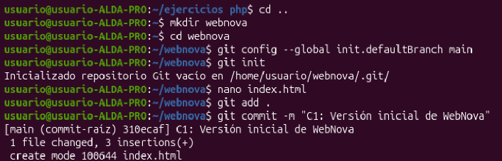
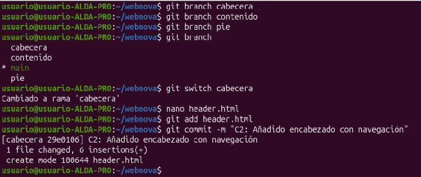
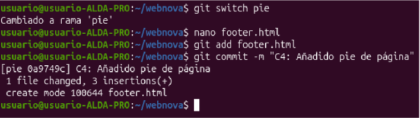
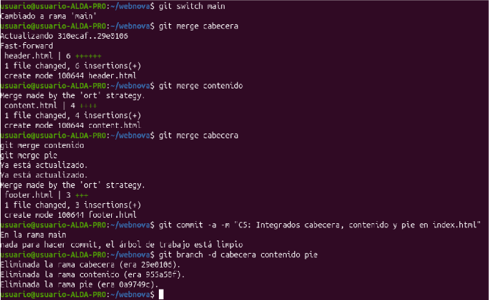
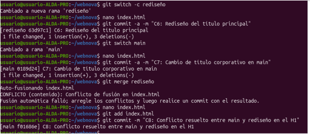
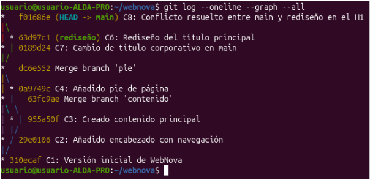

# Práctica 4. Gestión Avanzada de Ramas y Resolución de Conflictos

**Alumno:** Jose Antonio 
**Proyecto:** WebNova 

---

## 1. Capturas de Terminal (Evidencias de Ejecución)

### Captura 1: Preparación del Entorno 


### Captura 2: Desarrollo en Paralelo


### Captura 3: Desarrollo en la rama contenido


### Captura 4: Integración (Fusiones sin conflicto)


### Captura 5: Provocando y Resolviendo un Conflicto


### Captura 6: Visualización del Historial
```bash
git log --oneline --graph --all
```


---

## 2. Reflexión Teórica

* **¿Por qué ocurrió el conflicto en la PARTE 3 y por qué no ocurrió en la PARTE 2?** 
  En la parte 3 ocurrió el conflicto porque la rama `main` y la rama `rediseño` modificaron la misma línea exacta del archivo `index.html`, por lo que Git no pudo aplicar la versión de forma   automática. En cambio, en la parte 2 no hubo conflictos porque cada rama creó archivos por separado (`header.html`, `content.html` y `footer.html`).

* **Al ejecutar `git switch main` en la PARTE 3.2, ¿qué ocurrió con los archivos de tu directorio de trabajo?** 
  El puntero `HEAD` se movió de la rama `rediseño` a la rama `main` y el directorio de trabajo se actualizó de forma automática para reflejar el estado del último commit de la rama `main`.
